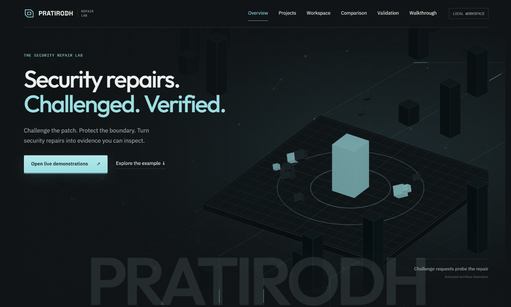

<h1>PRATIRODH</h1>

<strong>Make every security repair prove itself.</strong>

Reproduce the bug. Challenge the fix. Give reviewers evidence they can inspect.

 ·  ·  · 

[Get started](#run-locally) · [How it works](#how-it-works) · [Security and scope](#security-and-scope) · [Documentation](#documentation)

Overview interface snapshot · 6 October 2026

PRATIRODH is a local security-repair workbench for checking whether a proposed code fix addresses a reproduced vulnerability while preserving expected behavior. It retains failed attempts and verification evidence for human review.

## How it works

1. **Inspect a project:** review the source inventory, manifest, protected files, dependencies and test commands.
2. **Reproduce the issue:** establish vulnerable behavior and check the baseline.
3. **Prepare a candidate:** use a supplied patch or request an optional local-model suggestion.
4. **Challenge the change:** run regression and security checks, including weakened variants where supported.
5. **Review evidence:** inspect the diff, results and provenance; verify the signed export. A person makes the final decision.

The app does not write a repair back to the source project, commit it or deploy it. A signature protects evidence from unnoticed changes; it does not certify code as completely secure.

## What you can try

- **Python, JavaScript, C/C++ examples:** supplied multi-file repairs run in bounded Docker workers; no AI model is required.
- **Requests redirect example:** pinned-source demonstration of expected redirects and weakened repairs. Supplied-patch verification uses zero model calls. [Scope and provenance](docs/REQUESTS_DEMO.md).
- **Optional local AI:** Ollama can generate a candidate with Qwen2.5-Coder 7B. One recorded fixture repair made one model call and reached review readiness; that result does not measure general repair accuracy.
- **Signed review:** inspect the candidate, checks and provenance, then export and independently verify the evidence with the store's public trust key.
- **Project intake:** inspect a local source directory and review its manifest before execution. This is not ZIP upload or an automatic scan of arbitrary repositories.

## Run locally

**Requirements:** Python 3.11 and Docker using Linux containers. Ollama is optional for AI suggestions. Node.js/npm is only needed to rebuild or test frontend source; browser assets are included.

### Windows

From the repository folder:

    ./Start-Updated-Demo.ps1 -Port 8770

On first run, the launcher creates a virtual environment, installs hash-locked dependencies and prepares supplied-patch examples. Initial setup needs access to package repositories and Docker images. The dashboard binds to localhost. Keep the terminal open while using it; Ctrl+C stops the dashboard and preserves evidence.

Useful options:

    ./Start-Updated-Demo.ps1 -Port 8770 -Check
    ./Start-Updated-Demo.ps1 -Port 8770 -Requests -Fresh
    ./Start-Updated-Demo.ps1 -Port 8770 -Store PATH_TO_EVIDENCE_STORE -ReadOnly

If the port is occupied, choose another one. If Docker is unavailable, start Docker Desktop with Linux containers enabled. Restart reuses existing evidence; invalid evidence is not overwritten.

### macOS and Linux

    python3 -m venv .venv
    . .venv/bin/activate
    python -m pip install --only-binary=:all: --require-hashes -r requirements-deploy.txt
    python scripts/start_demo.py --port 8767

The documented Windows launcher is locally exercised. macOS/Linux host setup has not received the same end-to-end acceptance run.

### Optional local model

Run Ollama locally with cloud access disabled, then install and select the model:

    $env:OLLAMA_HOST = '127.0.0.1:11434'
    $env:OLLAMA_NO_CLOUD = '1'
    ollama serve
    ollama pull qwen2.5-coder:7b
    ./Start-Updated-Demo.ps1 -Port 8770 -Model qwen2.5-coder:7b

Generation requires enough local memory and may fail on constrained machines. Supplied-patch examples work without Ollama. The model has not been fine-tuned for PRATIRODH.

## A practical use

Use it as a private pre-merge review aid: reproduce a known issue in an isolated worker, challenge a candidate repair, then attach signed results to the team's normal review. An engineer still reviews and applies any accepted change through the existing Git workflow. GitHub branch and pull-request integration is not included.

## Security and scope

- Project commands run in bounded Docker workers with no external network. Signing keys stay with the controller.
- Execution depends on reviewed manifests and supported workflows. This is not a general-purpose scanner or an unreviewed production gate.
- The dated [OWASP Top 10:2025 assessment](docs/OWASP_ASSESSMENT_20261007.md) is a code-scope review, not certification or an independent penetration test.
- The worker has documented native-library and kernel-related residual risks. See the [30 October image review](docs/CI_IMAGE_ADVISORY_REMEDIATION_20261030.md). A passing CI gate means findings are reviewed, not all patched.
- Azure qualification for 24 upstream cases and the 216-run campaign are separate and incomplete. Azure execution is paused; public deployment is not configured.

## Architecture

The Flask controller reviews intake and coordinates budgets, execution and evidence. Docker workers receive approved snapshots and commands; signed exports bind results to recorded inputs.

    Inspect project → Reproduce issue → Prepare candidate → Challenge repair → Sign evidence → Human review

See [project workflows](docs/PROJECT_WORKFLOWS.md) for the supported manifests and checks.

## Verification

GitHub Actions runs the frontend build and tests, Python checks, Docker-enabled suite, dependency audits, image scan and advisory review. Check the [live main-branch status](https://github.com/armaan-1207/Pratirodh/actions/workflows/checks.yml). Results are tied to the revision tested; dated reports in docs preserve historical results.

## Documentation

- [Project workflows and manifests](docs/PROJECT_WORKFLOWS.md) · [Requests demonstration](docs/REQUESTS_DEMO.md)
- [Local security assistant and Hugging Face import](docs/LOCAL_SECURITY_ASSISTANT.md)
- [Model training pilot](docs/MODEL_TRAINING.md) — training setup only; no trained model has been evaluated or promoted
- [OWASP assessment](docs/OWASP_ASSESSMENT_20261007.md) · [image advisory review](docs/CI_IMAGE_ADVISORY_REMEDIATION_20261030.md)
- [Frontend attribution](docs/FRONTEND_DESIGN.md) · [third-party notices](docs/THIRD_PARTY_NOTICES.md)
- [Security policy](SECURITY.md) · [MIT License](LICENSE)

## Development

    npm ci
    npm run build
    npm test
    python -m pip install pytest==9.1.1 pip-audit==2.10.1
    python -m pratirodh build-runner
    python -m pratirodh project build-worker
    $env:PRATIRODH_DOCKER_TESTS = '1'
    python -m pytest -q
    python -m bandit -r pratirodh -ll
    pip-audit -r requirements-deploy.txt
